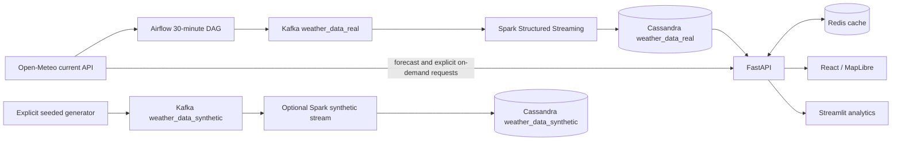

# WeatherPulse

WeatherPulse is an India-focused weather ingestion and analytics project. It collects scheduled Open-Meteo observations for a configurable set of Indian cities, streams them through Kafka and Spark Structured Streaming, persists them in Cassandra, and serves them through FastAPI to React and Streamlit dashboards. It is a local university BDA demonstration, not an official warning or area-wide weather monitoring service.

## Architecture



Airflow schedules collection. Kafka buffers acknowledged JSON events. Spark validates and flattens each message and upserts it into Cassandra. The API reads stored latest and historical observations, with Redis as a short-lived read cache. The React map visualizes persisted city samples and real administrative boundaries. Streamlit provides deeper stored-data analytics. Forecasts and explicitly on-demand unmonitored coordinates may use Open-Meteo directly and are labeled by source.

This is **near-real-time ingestion**, not continuous observation. Open-Meteo's `current.time` is the provider observation time; a scheduled DAG can ingest the same provider time twice. The Cassandra key `(city, timestamp, station_id)` uses that provider time, so retries update one row and a later provider observation creates a new historical row. Each event also has a stable SHA-256 `event_id`, `ingested_at`, and Spark `processed_at`. Times are UTC ISO-8601 strings; temperatures are Celsius, wind and gust km/h, pressure hPa, precipitation mm.

## Coverage and provenance

The registry at `backend/app/data/locations.json` contains **66 monitored cities**, including one designated primary city for each of India's **36 states and union territories** and 30 additional major cities. It is a curated set of point samples, not every city or settlement in India. `scripts/location_candidates.json` is the reviewed source list; `scripts/build_location_registry.py --write` resolves and checks its coordinates against the India boundaries before updating the registry. Review changes to IDs, names, districts, and coordinates before running that command. `WEATHER_MAX_LOCATIONS` is an optional positive cap; by default all registry entries are collected. `WEATHER_INGEST_MINUTES` controls the schedule (default 30). The collector requests up to ten coordinates per provider call, retries transient failures, falls back to per-city requests for failed batches, and fails a partially successful run so Airflow retries it. Stable provider-time event IDs and Cassandra upserts make repeated observations idempotent. Optional fields stay null. A zero rainfall reading is retained as zero.

The India overview reports an average **across reporting monitored locations**, reporting city and state counts, and mean sampled precipitation. Each state card uses its designated primary city's stored observation. These are point samples, not area-weighted national estimates. Weather alerts are local threshold flags, not official warnings. Unmonitored districts have no invented weather values.

State and district boundaries are derived from geoBoundaries gbOpen India ADM1 and ADM2 simplified GeoJSON. They replace the former rectangular placeholders. The ADM1 file has 36 state/UT shapes; the ADM2 file has 735 district shapes. ADM2 lacks a parent state code, so `scripts/build_boundaries.py` assigns one using an interior point and ADM1 polygons; one district needed the nearest polygon fallback. The two sources represent different years, so review boundary changes before official use. The files and licenses are credited in [DATA_LICENSES.md](DATA_LICENSES.md).

## Prerequisites and configuration

- Docker Desktop with Linux containers and Compose v2; allocate at least 8 GB to Docker for the full default stack.
- Internet access for the initial image and Spark connector downloads and live Open-Meteo collection.
- No Open-Meteo API key is required for this project's modest default request volume; review the provider's current usage terms before expanding the registry or frequency.

The default stack includes ZooKeeper, one Kafka broker, PostgreSQL, Airflow webserver and scheduler, one local-mode Spark streaming job, Cassandra, Redis, FastAPI, and React. This uses fewer resources than a separate Spark master and worker. Kafka, ZooKeeper, Cassandra, PostgreSQL, Redis, and Spark checkpoints use named volumes so a container recreation does not discard broker logs or stream offsets. Optional profiles are `analytics` (Streamlit), `synthetic` (isolated load test), `observability` (Schema Registry and Control Center), and `cluster` (Spark master and worker; set `SPARK_MASTER=spark://spark-master:7077` when using that profile). The observability services are not required by the JSON event pipeline.

Important environment variables: `WEATHER_INGEST_MINUTES`, `WEATHER_MAX_LOCATIONS`, `KAFKA_BOOTSTRAP_SERVERS`, `KAFKA_TOPIC`, `CASSANDRA_HOST`, `CASSANDRA_KEYSPACE`, `CASSANDRA_TABLE`, `REDIS_URL`, `CORS_ORIGINS`, and `STREAMLIT_BACKEND_URL`. Compose supplies network hostnames. Change development Airflow credentials and secret key before exposing the stack beyond localhost. The backend configuration is in `backend/app/config.py`.

## Start and verify

```bash
docker compose config --quiet
docker compose up -d --build
docker compose ps
docker compose exec -T scheduler airflow dags list-import-errors
docker compose exec -T scheduler airflow dags unpause weather_data_streaming
docker compose exec -T scheduler airflow dags test weather_data_streaming 2026-10-27
```

The DAG is configured unpaused on a new database. Existing Airflow metadata can retain an old paused state; run the explicit `unpause` command once. `dags test` performs live provider requests and publishes to Kafka. Wait for Spark to process the micro-batch, then inspect:

```bash
docker compose exec -T broker kafka-topics --bootstrap-server broker:29092 --describe --topic weather_data_real
docker compose exec -T cassandra_db cqlsh -e "SELECT city,timestamp,source,temperature,wind_gust,event_id FROM spark_streams.weather_data_real WHERE city = 'Leh' LIMIT 5;"
curl http://localhost:3000/api/cassandra/latest?city=Delhi
curl http://localhost:3000/api/cassandra/cities
curl http://localhost:3000/api/india/overview
```

The Cassandra primary key supports efficient latest and time-range reads **within a city partition**. `GET /api/cassandra/latest/batch?cities=Delhi&cities=Mumbai` performs bounded concurrent queries only for configured cities. `GET /api/cassandra/historical?city=Delhi&days=7` returns stored observations, up to 2,000 points per request. An empty set means no matching persisted records; it is not replaced by fabricated history. `GET /ready` checks application readiness. The React dashboard is at `http://localhost:3000`; Airflow is at `http://localhost:8080`.

`GET /api/geocode?q=Delhi` uses Open-Meteo name search restricted to India. `GET /api/geocode/reverse?lat=28.6139&lon=77.2090` finds only configured monitoring points within 50 km, marked `WP_MONITORED_POINT`. It is a nearby-point lookup, not a postal address or full administrative reverse geocoder; an empty result means no monitored point is nearby.

For Streamlit:

```bash
docker compose --profile analytics up -d --no-build streamlit
```

Open `http://localhost:8501`. The historical view and comparisons read Cassandra. The location-search view may make an explicitly on-demand provider request.

## Synthetic load test

The synthetic generator exists for throughput and replay demonstrations. It is opt-in, seeded, and writes only to `weather_data_synthetic` Kafka and Cassandra. Its readings carry `source=synthetic`, `generation_method=seeded-seasonal-v1`, and `quality_flags=synthetic;not-observed`. Temperature, humidity, cloud, rain, pressure, and wind are constrained and correlated heuristically; they are not scientifically observed weather. The default React and Streamlit views query only the real table.

```bash
docker compose --profile synthetic up -d --no-build spark-synthetic
docker compose --profile synthetic run --rm synthetic-producer --publish --per-location 10 --seed 42
docker compose exec -T cassandra_db cqlsh -e "SELECT COUNT(*) FROM spark_streams.weather_data_synthetic WHERE city = 'Delhi';"
```

Use `--end-time 2026-10-27T09:20:00+00:00` to replay a fixed period. Running the same seed and end time again upserts the same observation keys. A later end time adds distinct history. Do not use this stream in real-weather summaries.

## Development and tests

```bash
python -m unittest discover -s tests -v
pytest -q frontend/streamlit_dashboard/tests tests
cd frontend
npm ci
npm run lint
npm run build
```

The backend API mounts at `/api`. The React client uses the Nginx `/api` proxy in Docker; local development can set `VITE_API_URL`. The Streamlit client uses `STREAMLIT_BACKEND_URL`, which is `http://backend:8000` inside Compose.

See [VERIFICATION_REPORT.md](VERIFICATION_REPORT.md) for the checks actually run, their outcomes, and remaining gaps. A green container only proves that process or health probe is alive; verify Kafka, Cassandra, API, and browser data separately.

## Troubleshooting and limits

- Spark repeatedly restarts with `UnknownTopicOrPartitionException`: confirm `kafka-init` completed and `weather_data_real` exists. Do not delete checkpoint volumes to mask this error.
- After an upgrade from the old ephemeral Kafka configuration, an existing Spark checkpoint may refer to broker offsets that were lost before Kafka had a named volume. Preserve the old checkpoint for investigation, then deliberately configure a new checkpoint namespace after confirming persisted records. The default Compose file already uses `weather_data_real_v3` for this migration. Subsequent broker restarts retain the topic and offsets.
- No latest observations: check the DAG is unpaused, its task logs show published counts, Spark is running, and Cassandra has rows.
- Cassandra is slow to become healthy on first start; use `docker compose ps` and `docker compose logs cassandra_db` before retrying.
- The broker can briefly restart while recovering a persisted ZooKeeper session. Its longer health start period and the topic initializer's retries let Compose wait for a usable broker. If `docker compose up -d --build` still fails, inspect `docker compose logs broker kafka-init`; do not delete named volumes.
- Redis failure falls back to a short-lived local cache; Cassandra-backed endpoints still require Cassandra.
- The default single broker, one Cassandra node, Airflow SequentialExecutor, and local Spark are demonstration settings without high availability.
- Some district names differ across boundary vintages. Only exact reviewed district matches receive a stored city reading; other district polygons show no weather value.
- Historical query results are capped at 2,000 rows; pagination and long-term rollups remain future work.
- The React bundle is large and warrants code splitting. Visual browser QA could not be completed in the verification environment; see the report.

Images are built artifacts, containers are running instances, volumes hold persistent data, networks connect services, and build cache speeds rebuilds. A multi-service project legitimately uses multiple images. `docker compose down -v` and volume pruning delete persistent weather, Airflow, or Spark checkpoint data and must not be used for routine cleanup.
